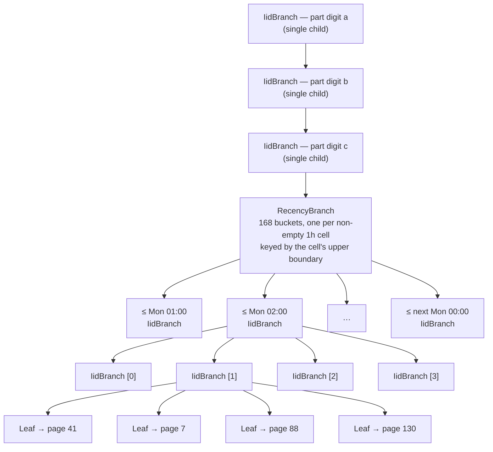

# Recency cells in historical files

With `compactor.withinFileRecencyBranching` on (#6042; #6263 makes it unconditional and removes the flag), a historical file is a set of time slices of its week — *cells* — each an ordinary IID trie.
This page shows what such a file looks like, how the compactor chooses its cells, and what a query reads from it.
It assumes you know the IID trie and its pages; the rules themselves are in [`compaction.allium`](compaction.allium) and `RecencyCells.kt`.

## What the layout serves

### Two queries, pulling in opposite directions

- **An aggregate over a short window** — the last hour, a day, an hour a week ago — wants each period's rows together, so it can skip the rest of the week.
  A week-long aggregate reads the week whatever the layout.
- **One entity's history over a period, up to a week**, wants its rows together, so it loads few pages.
  Within a page it finds them by binary search on IID.

Any layout inside a file trades one against the other.
Cells give the aggregate what it wants; the width of a cell is how much of that the entity's history gives up — see [How the compactor chooses the cells](#how-the-compactor-chooses-the-cells).

### Constraints the layout keeps

- **Historical files stay weekly.**
  Cells live inside a file; the trie key, the trie catalog's shards and every other recency at file level keep their day-resolution date, and the number of files doesn't change.
- **Every node compacting a job writes byte-identical output.**
  Compaction is coordination-free, so nodes run the same job at once, and a job's data and meta files are separate objects that different nodes can win.
  Two layouts of the same job would leave one node's meta file indexing another's data file.
  So the cells come from the job's own inputs alone, and every compacting node must agree whether to write them at all — which is what the flag's two-roll rollout arranges (`docs/src/content/docs/ops/config.md`).
- **A row's recency is fixed when it reaches L1H, and carried rather than recomputed.**
  An L1H → L2H job doesn't hold the events that superseded a row, so it couldn't recompute it; a row therefore never changes cell as it compacts up, and cells of one width nest inside any wider one across files and rounds.
- **The compactor streams.**
  It never holds the output file to branch it: the merge emits rows in IID order, each cell builds its IID trie online, and the writer holds about a page per cell, with no spill.
- **Same-transaction events are resolved before rows are split into cells**, since events with equal system time in different cells have no order between them at read time.
- **No recency branch is empty, and no IID branch has every child null.**

## One file, worked through

The example is an L5H file taking 10k rows an hour — a table taking 640k rows an hour, of entities each updated every five minutes.

- **The file is one IID shard of one week.**
  Its key is `l05-r20260112-p<a><b><c>-b…`: the week ending Monday 2026-01-12, and a part of three IID digits.
  L5H shards the week 64 ways, so the file holds 1/64 of the week's superseded rows — 10k an hour, 1.68M over the week.

- **Every row carries its `_recency`**, the time it was superseded, fixed when it reached L1H.

### The trie



- **The part's digits come first, as single-child IID branches**, as in any sharded historical file.
- **One recency branch sits below them**, with a bucket per cell that holds rows.
  A cell keyed by boundary `B` holds the rows with `B − 1h < _recency ≤ B`.
  Buckets are in ascending order of boundary, and an empty cell has no bucket.
- **Under each cell is an ordinary IID trie**, split four ways wherever a node holds more than a page.
  A cell here holds 10k rows, so with 1,024-row pages it splits twice: 16 leaves of about 625 rows.
  A quieter cell splits less, and a cell of at most a page is a single leaf.
- **More than a page of one entity in one cell becomes its own small recency branch**, a page at a time, each keyed by its newest row.
  It doesn't arise at this rate: an entity has 12 versions an hour.

### The pages

Seen from the scan, the file is a grid: cells along the week, IID down the shard.

```
              cell (1h, by upper boundary)
              Mon 01:00   Mon 02:00   Mon 03:00   …   next Mon 00:00
IID [0][0]       ■           ■           ■                  ■
IID [0][1]       ■           ■           ■                  ■
   …
IID [3][3]       ■           ■           ■                  ■

■ = one page: 168 cells × 16 IID prefixes ≈ 2,700 pages

an hour's aggregate reads a column:   1 cell  × 16 prefixes = 16 pages
one entity's week reads a row:      168 cells ×  1 prefix   = 168 pages
```

Wider cells shorten the row and widen the column; narrower cells do the reverse.

- **Each page holds one cell's rows for one IID prefix**, sorted by IID then system time as in any page.
- **A page's `_recency` lies within its cell.**
  Its page recency is the lower of its file's and its newest row's, which is never above its cell's boundary.
  - **Where each version is valid until the next, as with readings, its valid- and system-time ranges are narrow too.**
    Nothing in the layout bounds them; it follows from the data.
- **Pages of different cells interleave in the data file.**
  The compactor writes every cell at once from one IID-ordered merge, so a page lands when its leaf fills; the meta file addresses pages by index, and nothing reads the data file in order.

## How the compactor chooses the cells

**The width is the narrowest of 1h, 6h and 24h whose cells average at least four pages of the file's rows; where none does, the file has no cells.**
It comes from the job's own inputs, so every node compacting the same job picks the same cells.

- **The average is over the cells the file's actual `_recency` range touches**, its row count divided by their number.
  A file covering part of a week averages over the hours it has seen, not the whole week.
- **Four pages, not one, because it's an average.**
  Busy and quiet hours differ; a cell holding a quarter of the average still fills a page.
- **Each rung divides the next**, so a cell of one width lies wholly within a cell of any wider one, across files and rounds.
- **At most 168 cells cover a file**, since its recency lies within one week, so the writer's buffering — up to a page of rows per cell — needs no further cap.
- **Here, a 1h cell holds 10k rows, over four pages, so the file takes 1h.**
  Its IID trie splits twice: 16 leaves of about 625 rows, 0.61 full.

### What the bars mean

The bars, per file: 1h at 4,096 rows an hour or more, 6h at 683, 24h at 171; below that, no cells.
Back-of-envelope, per file, with 1,024-row pages, for the example and either side of each bar.
"No cells" is the same file as one IID trie over its week, split four ways until its leaves fit a page.

| file rows/h | width | pages per cell (rows each) | no cells: pages (rows each) |
|---|---|---|---|
| 10,000 (the example) | 1h | 16 (625) | 4,096 (410) |
| 4,100 | 1h | 16 (256) | 1,024 (673) |
| 4,000 | 6h | 64 (375) | 1,024 (656) |
| 700 | 6h | 16 (262) | 256 (459) |
| 670 | 24h | 16 (1,005) | 256 (440) |
| 175 | 24h | 16 (262) | 64 (459) |
| 165 | none | — | 64 (433) |

**An entity's week loads one page per cell on its IID path**, one page without cells, and binary-searches each on IID for its own rows.

- **The rows it reads are its own either way** — about 2,000 for an entity updated every five minutes; cells change how many pages it loads, not how many rows it reads.
- **A week is the worst case; a shorter history loads proportionately fewer pages** — a day's, 24 at 1h — since cells outside its span are pruned on recency.
- **Each page costs about log₂ of its rows in comparisons**, so even 168 pages is about 1,600.
- **The pages come from a file the buffer pool has fetched whole**, so a page load is a local read, not an object-store request.

| file rows/h | width | with cells: pages (rows loaded) | no cells: pages (rows loaded) | pages, cells ÷ no cells | comparisons, cells / no cells |
|---|---|---|---|---|---|
| 10,000 (the example) | 1h | 168 (105k) | 1 (410) | 168× | ~1,600 / ~9 |
| 4,100 | 1h | 168 (43k) | 1 (673) | 168× | ~1,300 / ~10 |
| 4,000 | 6h | 28 (10.5k) | 1 (656) | 28× | ~250 / ~10 |
| 700 | 6h | 28 (7.3k) | 1 (459) | 28× | ~220 / ~9 |
| 670 | 24h | 7 (7k) | 1 (440) | 7× | ~70 / ~9 |
| 175 | 24h | 7 (1.8k) | 1 (459) | 7× | ~56 / ~9 |
| 165 | none | 1 (433) | 1 (433) | 1× | ~9 / ~9 |

**An aggregate over the last hour reads the one or two cells the window touches** — one when the window is aligned to the cells, two when it straddles a boundary — and the whole file without cells.

| file rows/h | width | with cells: pages, rows | no cells: pages, rows | rows, cells ÷ no cells | ideal rows |
|---|---|---|---|---|---|
| 10,000 (the example) | 1h | 16–32, 10k–20k | 4,096, 1.68M | 1/168–1/84 | 10k |
| 4,100 | 1h | 16–32, 4k–8k | 1,024, 689k | 1/168–1/84 | 4k |
| 4,000 | 6h | 64–128, 24k–48k | 1,024, 672k | 1/28–1/14 | 4k |
| 700 | 6h | 16–32, 4k–8k | 256, 118k | 1/28–1/14 | 700 |
| 670 | 24h | 16–32, 16k–32k | 256, 113k | 1/7–1/3.5 | 670 |
| 175 | 24h | 16–32, 4k–8k | 64, 29k | 1/7–1/3.5 | 175 |
| 165 | none | 64, 28k | 64, 28k | 1 | 165 |

The two ratios are the trade: a width that multiplies an entity's page loads by k divides an aggregate's rows by about k, because both count the week's cells.

- **Below a bar, an aggregate never reads more than a few tens of thousands of rows per file**, while an entity's week drops from 168 pages to 28, 7, then 1.
- **Just over each bar, pages are about a quarter full.**
  A cell just over four pages splits into 16; it costs meta and page loads, not rows read, and fill recovers as the rate grows.

## What a query reads

- **A query over the last hour reads one or two cells per file.**
  Phase 1 of `filter-pages` emits a page only if the query's lower bound — the earlier of its valid- and system-time starts — is below the page's recency, so no cell superseded before the window is emitted.
  Phase 2 brings such a page back only where it can still affect an emitted row: it may hold an erase, or the query projects unclamped temporal columns that the page's rows bound.
  Across the week's 64 L5H files that is 1,000–2,000 pages and 640k–1.3M rows, against the 640k the window holds.

- **A query over an hour a week ago is pruned from both sides.**
  Recency drops the cells superseded before the window; the remaining cells' pages are dropped by their own valid- and system-time ranges, which are narrow because each page sits in one cell.

- **One entity's week reads one page per cell.**
  Its IID path picks one leaf in each of the 168 cells, and a binary search on IID finds its rows inside each page.
  So it loads 168 pages, about 105k rows, but searches each in about ten comparisons and reads only its own rows — some 2,000 for an entity updated every five minutes; its cost is the page loads.
  Without cells it is one page per file; this is the trade the cell width sets.

- **A wide window merges a page from every cell at each IID path.**
  The scan K-way merges an entity's pages across cells, about 168 a week, though cells don't overlap in recency.

## What a file without cells looks like

- **With the flag off, a historical file is the IID trie of earlier releases**: no `_recency` column, no recency branch, and every page has the file's recency — the end of its week.
- **With the flag on, a job writes no `_recency` and no cells where any of its inputs lacks the column**, so its output is the flag-off file.
  Files written before the flag went on drop out of a week as it compacts, after which every job in it carries the column.
- **With the flag on and every input carrying `_recency`, a file still has no cells where even 24h cells average under four pages**: it is one IID trie, but it keeps the column and its pages' recency comes from their newest rows.
